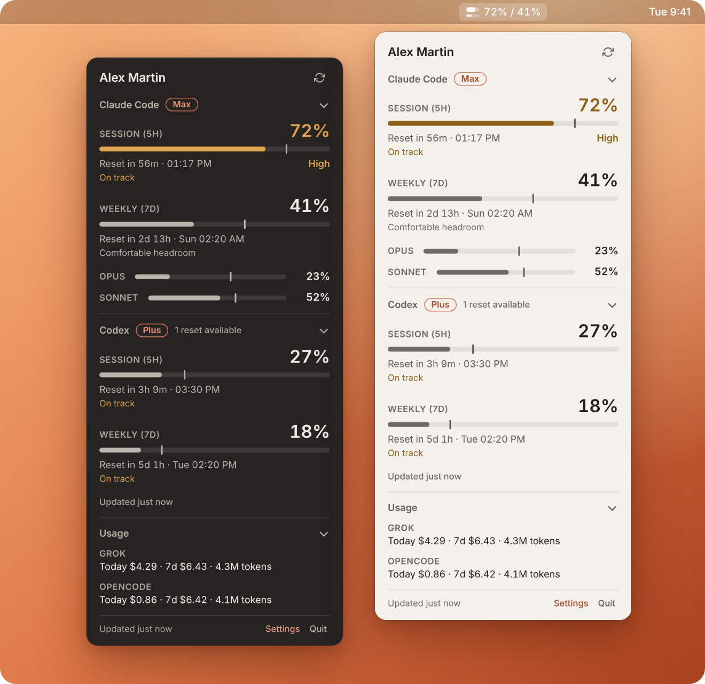

<div align="center">

<picture>
  <source media="(prefers-color-scheme: dark)" srcset="assets/logo-readme-dark.svg">
  
</picture>

<p><strong>Your AI coding quotas, in the macOS menu bar.</strong><br>
Claude Code and Codex limits with a forecast, Grok and OpenCode spend, at a glance.</p>

<p>
  <a href="https://github.com/TimothePorterie/burnbar/releases/latest"></a>
  
  
  <a href="LICENSE"></a>
  <a href="https://github.com/TimothePorterie/burnbar/actions/workflows/ci.yml"></a>
</p>



</div>

## Why BurnBar

Coding agents stop when a quota runs out, and each tool hides its numbers in a different place. BurnBar puts them in one menu bar item:

- How much of the 5-hour session and the weekly window you have used, for Claude Code and Codex.
- When each window resets, and whether your current pace runs out before that.
- What Grok and OpenCode cost you today and over the last 7 days.

It reads what the official tools already know. It has no account, no login, and no server of its own.

BurnBar is an independent project. It is not affiliated with Anthropic, OpenAI, xAI, or OpenCode.

## Features

| Tool | What BurnBar shows | Where it comes from |
|------|--------------------|---------------------|
| **Claude Code** | Session (5 h) and weekly (7 d) quotas, per-model weekly quotas (Opus, Sonnet, Haiku, Fable) when present, extra usage beyond the plan, plan badge, Anthropic incidents | Claude Code's sign-in, read from the macOS Keychain, then Anthropic's usage endpoint and the public [status page](https://status.claude.com) |
| **Codex** | Session and weekly quotas, plan badge, available limit resets, "usage limit reached" | The local `codex app-server` from the official Codex CLI |
| **Grok** | Spend and tokens: today and last 7 days | `grok usage` from the official Grok CLI |
| **OpenCode** | Spend and tokens: today and last 7 days | `opencode stats` from the official OpenCode CLI |

Grok and OpenCode expose no official limits, so BurnBar shows consumption only for them: no quota, forecast, or alert.

For every quota:

- **One meter per window.** The fill is what you used. A tick marks how much of the window has elapsed, so a fill past the tick means you are ahead of the clock.
- **Levels.** From 70% the popup says **High**, from 90% **Critical**. The thresholds are fixed.
- **Reset and pace.** `Reset in 3h 9m · 3:30 PM`, then **High pace**, **On track**, or **Comfortable headroom**. When the current rate would reach 100% before the reset: `Runs out around 1:28 PM, 32m before reset`.
- **Data age.** "Updated 5m ago". Stale data or a failed refresh turns it orange and dims the menu bar icon.

The popup has one section per tool you turn on. Click a section header to fold it to a one-line summary; BurnBar remembers it.

## Menu bar

The icon is a small gauge: the thick bar is the session, the thin bar is the weekly window. Next to it, the title follows the display mode you pick with a right-click → **Display Mode**:

| Mode | Example |
|------|---------|
| Standard | `45% / 32%` (session / weekly) |
| Detailed | `5h: 45% \| 7d: 32% \| Opus: 10%`, or `Claude 45% / 32% · Codex 22% / 12%` when both are on |
| Compact | `45%` |
| Time Remaining | `4h 30m` until the session resets |
| Icon only | No text |

**Menu bar shows** in Settings picks the tool behind the icon and title: Claude, Codex, or Highest (each bar and the title follow the more loaded of the two). `—` means there is no active session window.

**Show remaining** (Settings or the right-click menu) switches every percentage to what is left: `58% left` instead of `42%`. Meters, levels, and forecasts keep their meaning.

Hover the icon for a tooltip with each window, its reset time, the data age, and the last error. Left-click opens the popup. In the popup, Esc closes it, ⌘R refreshes, ⌘, opens Settings, and ⌘Q quits.

## Notifications

One switch, **Alerts**, covers all of them:

- A quota crosses 70%, then 90%: once per level, for the Claude session, weekly, and model quotas, and for the Codex session and weekly quotas.
- A session or weekly window resets after reaching 70% or more: "Session quota reset. You can resume."
- Claude extra usage: when billing beyond your plan starts, then at 50% and 90% of your monthly limit.

Nothing is sent from stale data or after a failed refresh. Grok and OpenCode never notify.

## Install

1. Download the DMG for your Mac from the [latest release](https://github.com/TimothePorterie/burnbar/releases/latest): `arm64` for Apple silicon, `x64` for Intel.
2. Open it and drag **BurnBar** to Applications.
3. Open BurnBar. It lives in the menu bar and has no Dock icon.

Releases are signed and notarized. Requires macOS 13 or later.

On first launch BurnBar turns on each tool it finds: Claude Code when its Keychain item exists, the others when their command is installed. Change this later under **Settings → Providers**.

To read Claude Code's sign-in, macOS asks for access to the Keychain item `Claude Code-credentials`. Choose **Always Allow**, or the prompt comes back at every refresh.

## Setup per tool

Each tool must be installed and signed in with its own CLI. BurnBar finds the commands in your login shell's `PATH`, Homebrew, `~/.local/bin`, `~/.bun/bin`, `~/.volta/bin`, and nvm's Node versions.

**Claude Code.** Install [Claude Code](https://code.claude.com) and sign in by running `claude`. Switching accounts in Claude Code switches BurnBar too.

**Codex.** Install the [Codex CLI](https://github.com/openai/codex) and run `codex login`.

**Grok.** Install the official Grok CLI (`grok`) and use it as usual. BurnBar lists the sessions in `~/.grok/sessions/` and asks `grok usage` for those modified in the last 7 days. A session counts on the day it was last updated.

**OpenCode.** Install [OpenCode](https://opencode.ai). BurnBar runs `opencode stats --standalone`, so no OpenCode server is left running.

Claude Code and Codex refresh every 5, 10, or 15 minutes. Grok and OpenCode refresh at most every 15 minutes.

## Privacy and security

- **Read-only.** BurnBar reads Claude Code's Keychain item and never writes, refreshes, or copies it. Claude Code owns its sign-in.
- **No tokens for the other tools.** BurnBar never opens `~/.codex/auth.json` or any Grok or OpenCode credential. It runs their official CLIs and reads the numbers they print. For Grok it reads only session folder names and modification times.
- **Official tools only.** No scraping, no undocumented endpoint called with your token. Each CLI call has a timeout and its process is stopped afterwards.
- **No in-app login.** [Anthropic's terms](https://code.claude.com/docs/en/legal-and-compliance) (Authentication and credential use) do not allow a third-party app to offer Claude.ai login or to collect and store Claude.ai tokens. BurnBar does neither: you sign in with Claude Code.
- **Network.** BurnBar itself connects to `api.anthropic.com` (usage), `status.claude.com` (incidents), and GitHub (updates). No analytics. The CLIs it runs talk to their own services as they always do.
- **Hardened app.** Sandboxed renderers with context isolation, a strict Content Security Policy, and Electron fuses that block Node options and debugging flags.

## Settings

Right-click the icon → **Settings…**, or ⌘, in the popup.

- **Account**: Claude Code's connection, account, and plan. **Refresh** reads it again.
- **Providers**: one switch per tool with its status (Connected, Installed, Not installed, Not connected), and **Menu bar shows**.
- **General**: language (English, French), appearance (Auto, Light, Dark), refresh interval (5, 10, 15 min), Alerts, Open at login, Show remaining.
- **Updates**: check, download, and **Install & Restart**. BurnBar also checks at launch and every 6 hours.

Refreshes pause after 10 minutes of inactivity or while the screen is locked, and resume once the data is 30 minutes old. Opening the popup or unlocking the Mac asks for fresh numbers.

## Troubleshooting

Each error in the popup and the tooltip says what to do. The common ones:

| Message | Fix |
|---------|-----|
| Claude Code is not connected / No Claude Code session found | Run `claude` and sign in, then click **Retry**. |
| Claude Code token expired / saved session can't be read / Anthropic refused this session | Run `claude` again. BurnBar never refreshes the token itself. |
| Keychain access was denied | Click **Retry** and choose **Always Allow**. |
| Couldn't read the Keychain | Unlock the login Keychain, allow BurnBar when macOS asks, then click **Retry**. |
| Anthropic rate limit reached | Wait. The popup shows the next automatic try; BurnBar backs off for at least 2 minutes. |
| Offline, or Anthropic can't be reached / Anthropic server error | Check your connection or [status.claude.com](https://status.claude.com). BurnBar retries with a growing delay. |
| Codex is not signed in | Run `codex login`. |
| Codex CLI not found / Grok CLI not found / OpenCode CLI not found | Install the CLI, or turn the tool off in **Settings → Providers**. If it is installed, make sure your login shell's `PATH` includes it. |
| Couldn't read Codex limits | Update Codex. |
| Couldn't read all Grok usage | One or more sessions could not be read; totals may be low until the next refresh. |

A manual refresh within 15 seconds of the last one only shows "Already up to date". Logs are in `~/Library/Application Support/burnbar/logs/burnbar.log`.

If **Open at login** needs approval, Settings shows a button that opens System Settings → General → Login Items.

## Upgrading from Claude Bar

BurnBar is the new name of Claude Bar, starting with version 2.0.0.

- **Settings carry over.** On first launch BurnBar copies Claude Bar's settings (refresh interval, display mode, alerts, language) if it has none yet.
- **Auto-update works.** Claude Bar 1.8 offers the update like any other: the repository moved to `TimothePorterie/burnbar` and GitHub redirects the old address. The bundle identifier is unchanged, so macOS keeps your notification and login item permissions.
- **The app may keep its old name on disk.** An in-place update replaces the contents of `Claude Bar.app` without renaming it. Rename it in Finder after quitting, or install the DMG and delete the old copy.
- **Claude Code must be signed in.** The in-app login of Claude Bar 1.x is gone. Run `claude` once if you only signed in through Claude Bar.

## Development

BurnBar is Electron 45, TypeScript, and electron-vite.

```bash
git clone https://github.com/TimothePorterie/burnbar.git
cd burnbar
npm ci
npm run dev          # run with hot reload
npm run typecheck
npm test             # Vitest
npm run build        # production bundle
npm run dist         # DMG and ZIP, arm64 and x64, in release/
```

`scripts/mac-dev.sh` runs on a Mac: it copies a remote working tree over SSH, builds it, relaunches the app, and tails the log. `scripts/render-icons.mjs` renders the app icon and `scripts/render-readme-shots.mjs` renders the image above from the real app under xvfb; both take a `playwright-core` path in `PLAYWRIGHT_CORE`.

Architecture, data flow, and conventions are in [AGENTS.md](AGENTS.md). Changes are in [CHANGELOG.md](CHANGELOG.md).

## License

[MIT](LICENSE)
